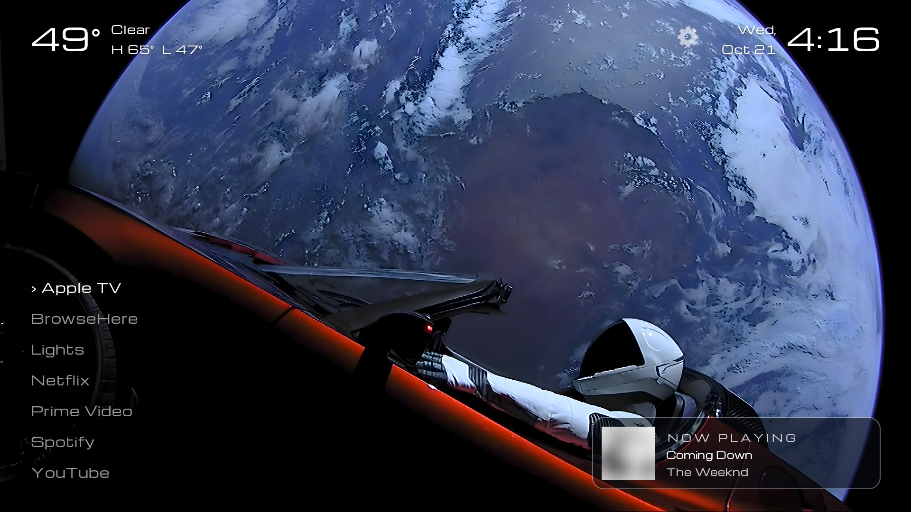
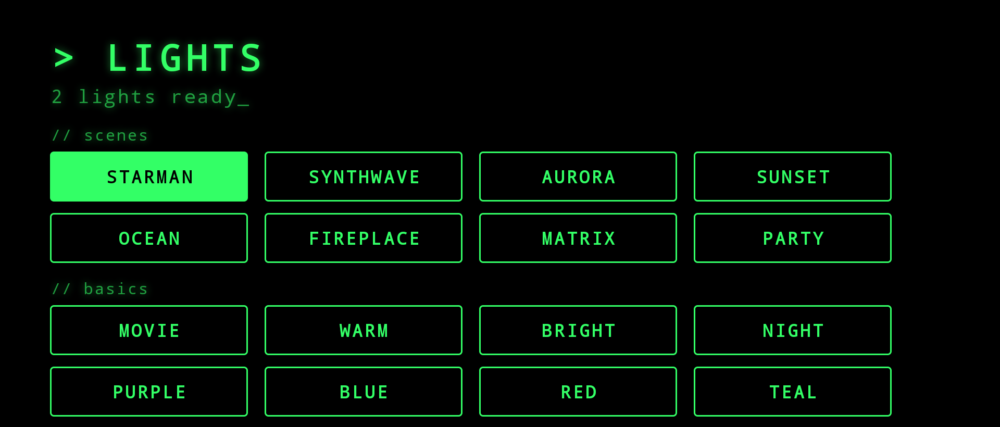

<h1 align="center">🚀 Liftoff</h1>

<p align="center"><b>Give your Google TV a clean, fast, ad-free home screen in one conversation with an AI agent.</b><br>
Tell Claude Code or Codex which apps you want. It does the rest over your Wi-Fi, and every change can be undone.</p>

<p align="center"></p>

<p align="center">
<a href="#quick-start">Quick start</a> ·
<a href="#what-you-get">What you get</a> ·
<a href="#what-it-changes-and-how-to-undo-it">What it changes</a> ·
<a href="#safety">Safety</a> ·
<a href="#do-it-by-hand">By hand</a>
</p>

---

Stock Google TV is a billboard: rows of "recommended for you," autoplaying trailers, preinstalled apps
you never asked for, and (on many TVs) software that reports what you watch. **Liftoff replaces all of
that with the things you actually use**, and hands the whole job to an AI coding agent so you don't have to
learn ADB.

## Quick start

1. **On the TV:** Settings → System → About → press OK on *Android TV OS build* 7 times.
   Then Settings → System → Developer options → turn on **USB debugging**.
2. **On your computer** (macOS or Linux), clone this repo and open your agent in it:
   ```bash
   git clone https://github.com/OWNER/liftoff && cd liftoff
   claude        # or: codex
   ```
3. **Paste this**, with your own apps:
   > Set up Liftoff on my TV. I want Netflix, YouTube, Spotify and Plex on the home screen.
   > Weather for Austin, TX. Follow AGENTS.md.

The agent finds your TV, backs it up, builds the home screen, shows you what it wants to turn off, and
waits for your OK before it touches anything. When the TV asks *"Allow USB debugging?"*, choose
**Always allow** and press OK.

## What you get

**A home screen that's just your apps.** An alphabetical text list, a big clock, today's weather, and
nothing else. No ads, no rows, no trailers. Press the gear for the TV's own settings.

**A new background every morning.** NASA's Astronomy Picture of the Day, or the bundled SpaceX
"Starman" photo, or your own picture.

**Now Playing.** When music plays (Spotify or any app you choose), a glass card with the album art,
song and artist floats in the corner of the home screen.

**Lights, if you have them.** Govee lamps with LAN Control get a retro terminal panel with animated
scenes (Aurora, Synthwave, Fireplace, Party…) and basics (Movie, Warm, Night). Local network only: no
Govee account, no cloud.

<p align="center"></p>

**A quieter TV.** The agent disables the preinstalled junk you approve: ad trackers like Samba TV, promo
pop-ups, silent app installers, store-demo apps, and streaming apps you don't use. It can also point the
whole TV at [AdGuard DNS](https://adguard-dns.io/) to block ad and tracker domains, and speed up menu animations.

## What it changes, and how to undo it

| Change | How | Undo |
|---|---|---|
| Home screen | Installs the Liftoff app and makes it the Home app | `scripts/undo.sh` gives Home back and uninstalls it |
| Preinstalled apps | **Disabled**, never uninstalled, and only the ones you approve | Re-enabled by `undo.sh`, or one at a time |
| DNS, animations, TCL privacy switches | Android settings; each old value is recorded first | Restored by `undo.sh` |
| Background activity | Optional per app (e.g. stop YouTube running in the background) | Restored by `undo.sh` |

Everything is recorded in `state/<your-tv>/` on your computer, together with a full snapshot taken before
the first change. `scripts/undo.sh` puts the TV back exactly as it was.

## Safety

The playbook in [AGENTS.md](AGENTS.md) holds the agent to these rules:

- **Backup first.** The scripts refuse to change anything until a backup exists.
- **Disable, never uninstall.** Everything comes back with one command.
- **You approve the list.** Nothing is disabled until you've seen it and said yes.
- **Hands off the essentials.** Play Services, Play Store, keyboards, HDMI inputs, remote pairing,
  Bluetooth and Settings are on a hard-coded block list.
- **No root, no sign-ins, no pirate apps.** Plain ADB only. The agent never types your passwords.

## Works with

Built and tested on **TCL Google TVs** (Android 11 and 12, MediaTek). The home screen, Now Playing,
weather and lights only use standard Android APIs, so they should work on any Google TV or Android TV
running Android 9 or later (Sony, Hisense, Philips, Chromecast with Google TV…), but those aren't tested yet. The debloat catalog is TCL- and Google-heavy today. **PRs with other brands'
bloat are very welcome**: add rows to [`catalog/debloat.tsv`](catalog/debloat.tsv).

## Do it by hand

```bash
cp liftoff.example.json liftoff.json     # edit: tv address, apps, weather, lights…
scripts/setup-toolchain.sh               # once, if you don't have adb + JDK 17 + Android build tools
scripts/find-tv.sh                       # find the TV, approve the prompt on screen
scripts/backup.sh
scripts/build.sh && scripts/install.sh   # --no-home to try it without switching
scripts/cleanup-list.sh                  # read it, then:
scripts/debloat.sh <package> …
scripts/tweaks.sh
scripts/undo.sh                          # whenever you want it all back
```

Extras: `scripts/key.sh home|back|ok|…`, `scripts/screenshot.sh`, `scripts/ui.sh`,
`scripts/youtube.sh <url>`, `scripts/govee.py <ip> on|off|color r g b`.

## FAQ

**Will this break my TV?** It's designed not to: nothing is uninstalled, the essentials are blocked,
and `undo.sh` reverses everything. The one known rough edge: disabling the stock Google TV home can make
some TVs forget saved Wi-Fi, so the agent asks twice before doing it and you should have your Wi-Fi password handy.

**Does it survive a reboot?** Yes. Disabled apps stay disabled and Liftoff stays the Home app.

**Can I still use the Play Store?** Yes. Open it from the gear (Settings → Apps), or add
`com.android.vending` to your apps list.

**What about TV firmware updates?** On TCL, re-enable `com.tcl.ttvs` before checking for an update.

**Why no Gradle?** The app is a few hundred lines with no dependencies. `scripts/build.sh` uses the plain
Android build tools, so a build takes seconds.

## Credits

Michroma typeface (SIL OFL), SpaceX "Starman" photo (CC0), weather by [Open-Meteo](https://open-meteo.com/),
pictures from [NASA APOD](https://science.nasa.gov/apod/). Details in [THIRD_PARTY.md](THIRD_PARTY.md).
Not affiliated with Google, TCL, NASA, SpaceX or Govee.

MIT licensed.
